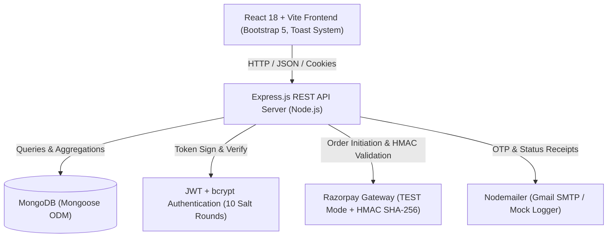
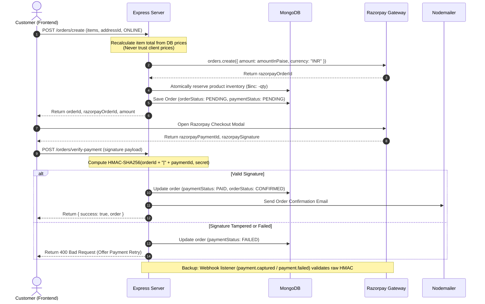
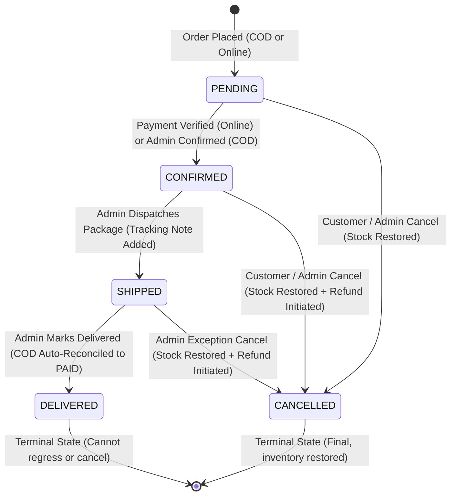

# 🛒 ShopVilla — Full-Stack MERN E-Commerce Platform

> **A production-ready, interview-grade MERN (MongoDB, Express, React, Node.js) e-commerce application designed for final-year engineering students and junior full-stack developers.**

---

## 🌟 Table of Contents
1. [Project Overview](#-project-overview)
2. [System Architecture & Tech Stack](#-system-architecture--tech-stack)
3. [Payment & Order Lifecycle Architecture](#-payment--order-lifecycle-architecture)
4. [Database Design & Data Models](#-database-design--data-models)
5. [Key Engineering Highlights (Interview Talking Points)](#-key-engineering-highlights-interview-talking-points)
6. [Monorepo Directory Structure](#-monorepo-directory-structure)
7. [REST API Documentation](#-rest-api-documentation)
8. [Getting Started & Local Setup](#-getting-started--local-setup)
9. [Automated Testing Suite (Jest + Supertest)](#-automated-testing-suite-jest--supertest)
10. [Pre-Seeded Demo Credentials](#-pre-seeded-demo-credentials)

---

## 📖 Project Overview

**ShopVilla** is an end-to-end e-commerce solution engineered with a focus on code cleanliness, resilient error handling, strict security, and transactional integrity. 

It covers the complete customer and administrator lifecycles:
- **Customer Journey:** Self-registration with 6-digit email OTP verification, catalog search and multi-criteria filtering, persistent shopping bag, multi-address book with Indian 10-digit phone and 6-digit pincode validation, Razorpay payment processing (TEST mode) with HMAC-SHA256 signature verification or Cash on Delivery (COD), order tracking visual stepper, retry failed payment, and verified product reviews.
- **Admin Console:** Real-time business analytics (revenue, order counts, customer registrations, low stock warnings), catalog CRUD management with stock controls, customer management, and order fulfillment status transitions backed by a strict state machine.

---

## 🏗 System Architecture & Tech Stack



### Frontend (`/client`)
- **React 18 (Vite):** Fast HMR (Hot Module Replacement) and optimized tree-shaken production bundles.
- **React Router v6:** Declarative nested routing with `ProtectedRoute` and `AdminRoute` guards.
- **Context API (`AuthContext`, `CartContext`, `ToastContext`):** Lightweight, centralized state management without excessive Redux boilerplate.
- **Axios:** Centralized HTTP instance with request/response interceptors for automatic JWT injection and unified error normalization.
- **Bootstrap 5 & Bootstrap Icons:** Fully responsive UI styled in a warm comfortable orange theme (`#ea580c` / `#f97316` / `#fff7ed`), zero purple.
- **Toast Notifications:** Global floating alert system for instant feedback on cart actions, reviews, and status changes.

### Backend (`/server`)
- **Node.js & Express.js:** Modular routing, middleware chains, rate limiting (`express-rate-limit`), security headers (`helmet`), and input sanitization (`express-mongo-sanitize`).
- **MongoDB & Mongoose:** Schema validation, compound indexing, Mongoose aggregate pipelines, and TTL indexes for OTP expiry.
- **JWT (JSON Web Tokens):** Secure authentication delivered via Authorization headers and HTTP-only cookies.
- **Bcrypt.js:** Salted password and OTP hashing (10 salt rounds).
- **Razorpay (Test Mode):** Server-side order creation in paise, cryptographic HMAC-SHA256 signature verification, retry payment capability, and webhook signature verification (`payment.captured` / `payment.failed`).

---

## 🔄 Payment & Order Lifecycle Architecture

### 1. Payment Flow (Razorpay + Webhook Backup)



### 2. Order Fulfillment State Machine



#### State Machine Transition Rules:
| Current Status | Allowed Next Statuses | Actor | Stock Action | Payment Action (Prepaid) |
| :--- | :--- | :--- | :--- | :--- |
| `PENDING` | `CONFIRMED`, `CANCELLED` | Customer, Admin | Restores stock on cancel | Sets `FAILED` or `REFUND_INITIATED` |
| `CONFIRMED` | `SHIPPED`, `CANCELLED` | Admin (Ship), Customer/Admin (Cancel) | Restores stock on cancel | Sets `REFUND_INITIATED` (triggers refund API) |
| `SHIPPED` | `DELIVERED`, `CANCELLED` | Admin | Restores stock on cancel | Sets `REFUND_INITIATED` |
| `DELIVERED` | None (Terminal) | — | Locked | If COD, marked `PAID` automatically |
| `CANCELLED` | None (Terminal) | — | Already restored | Final audit recorded |

---

## 🗄 Database Design & Data Models

- **User:** `name`, `email` (unique, lowercase), `phone`, `password` (bcrypt hash, `select: false`), `role` (`user`/`admin`), `isVerified` (boolean), `addresses[]` (embedded: `fullName`, `phone`, `line1`, `line2`, `landmark`, `city`, `state`, `pincode`, `isDefault`).
- **Product:** `name`, `description`, `price`, `category`, `images[]`, `stock`, `ratingAverage`, `ratingCount`, `createdAt`.
- **Review:** `user` (ref), `product` (ref), `rating` (1-5), `comment`. Compound unique index `[product, user]` enforces strictly one review per customer per product. Static aggregation automatically re-calculates `ratingAverage` and `ratingCount` on insert, update, or deletion.
- **Cart:** `user` (ref), `items[{ product: ref, quantity }]`. Persisted in MongoDB with real-time stock-capping logic.
- **Order:** `user` (ref), `items[{ product: ref, name, price, quantity }]` (immutable price snapshots), `shippingAddress` (immutable address snapshot), `itemsTotal`, `shippingFee`, `totalAmount`, `paymentMethod` (`ONLINE`/`COD`), `paymentStatus` (`PENDING`/`PAID`/`FAILED`/`COD_PENDING`/`REFUND_INITIATED`/`REFUNDED`), `orderStatus` (`PENDING`/`CONFIRMED`/`SHIPPED`/`DELIVERED`/`CANCELLED`), `razorpayOrderId`, `razorpayPaymentId`, `statusHistory[{ status, timestamp, note, updatedBy }]`.
- **Otp:** `email`, `otp` (bcrypt hash), `purpose` (`VERIFICATION`/`PASSWORD_RESET`), `attempts` (default: 0), `lastSentAt`, `expiresAt` (5-minute TTL index).

---

## 💡 Key Engineering Highlights (Interview Talking Points)

1. **Security & Cryptography:**
   - Passwords and OTPs hashed with `bcryptjs` using 10 salt rounds. Plaintext is never saved or logged.
   - `select: false` on Mongoose password path prevents accidental leakage during generic user queries.
   - Razorpay HMAC-SHA256 signature verification guarantees payment receipts cannot be spoofed by client manipulation.
   - Helmet HTTP headers, CORS origin whitelisting with cookie credentials, rate limiting, and NoSQL injection sanitization (`express-mongo-sanitize`).
2. **Defensive Price Recalculation:**
   - The backend NEVER trusts price or total calculations supplied by the frontend. Every order calculation queries current database prices to compute the exact amount in Indian paise.
3. **Atomic Stock Decrement & Concurrency Safety:**
   - Stock reduction uses atomic MongoDB `$inc` operations with a condition check `{ _id, stock: { $gte: quantity } }` to prevent overselling or race conditions under concurrent checkout requests.
   - If a payment verification fails or the order is cancelled, inventory stock is restored.
4. **Resilient OTP Verification Lifecycle:**
   - 6-digit numeric OTP generated and bcrypt hashed.
   - 5-minute MongoDB TTL index for automatic document garbage collection.
   - Max 3 verification attempts limit to block brute-force guessing.
   - 60-second cooldown rate limit between consecutive resend requests.
5. **Interview-Grade UI Architecture:**
   - Single-line comments throughout the entire codebase for clean presentation.
   - Comfortable warm orange color theme (`#ea580c` / `#f97316` / `#fff7ed`) with zero purple.
   - Toast feedback system, interactive visual order status tracker, and admin management modals.

---

## 📁 Monorepo Directory Structure

```
d:/SHOPVILLA/
├── package.json              # Root npm workspace runner scripts
├── README.md                 # Complete documentation & interview guide
│
├── server/                   # Backend Node.js / Express.js Application
│   ├── .env                  # Environment secrets & configuration
│   ├── .env.example          # Environment template
│   ├── package.json          # Server dependencies & scripts
│   ├── server.js             # HTTP server listener
│   ├── app.js                # Express app setup, security middleware, routing
│   ├── seed.js               # Database seeder (Admin + 20 sample products)
│   │
│   ├── config/               # Infrastructure connections
│   │   ├── db.js             # Mongoose MongoDB connection
│   │   ├── nodemailer.js     # Nodemailer transporter & mock fallback
│   │   └── razorpay.js       # Razorpay SDK initialization
│   │
│   ├── models/               # Mongoose Schema Definitions
│   │   ├── User.js           # User schema with embedded addresses & bcrypt hook
│   │   ├── Product.js        # Product schema with stock & ratings
│   │   ├── Review.js         # Review schema with compound index & calcAverageRatings
│   │   ├── Cart.js           # Shopping bag schema
│   │   ├── Order.js          # Order schema with immutable snapshots & audit log
│   │   └── Otp.js            # OTP schema with TTL index & attempts counter
│   │
│   ├── controllers/          # Business logic handlers
│   │   ├── authController.js # Auth, OTP verification, password reset
│   │   ├── productController.js # Catalog browsing & admin CRUD
│   │   ├── reviewController.js  # Review posting & deletion
│   │   ├── cartController.js    # Persistent cart operations
│   │   ├── addressController.js # Saved addresses CRUD
│   │   ├── orderController.js   # Checkout, Razorpay HMAC, retry, cancel, webhook
│   │   └── adminController.js   # Analytics, status transitions state machine, customers
│   │
│   ├── middleware/           # Pipeline filters
│   │   ├── authMiddleware.js # JWT verification
│   │   ├── roleMiddleware.js # Admin role verification
│   │   ├── errorHandler.js   # Centralized error formatter
│   │   ├── rateLimiter.js    # Rate limiting for auth & API
│   │   └── validators.js     # Express-validator schemas (Indian phone & pincode)
│   │
│   ├── routes/               # Route definitions
│   │   ├── authRoutes.js
│   │   ├── productRoutes.js
│   │   ├── reviewRoutes.js
│   │   ├── cartRoutes.js
│   │   ├── addressRoutes.js
│   │   ├── orderRoutes.js
│   │   └── adminRoutes.js
│   │
│   ├── services/             # Third-party integrations
│   │   ├── emailService.js   # Nodemailer HTML templates
│   │   ├── otpService.js     # OTP generation & validation
│   │   └── razorpayService.js# Razorpay orders, signatures, refunds
│   │
│   ├── utils/                # Helper utilities
│   │   ├── appError.js       # Custom operational error class
│   │   ├── catchAsync.js     # Async controller wrapper
│   │   └── apiFeatures.js    # Search, filter, sort, paginate
│   │
│   └── tests/                # Test suite
│       └── api.test.js       # 26 Jest & Supertest unit/integration tests
│
└── client/                   # Frontend SPA (React + Vite)
    ├── index.html            # Entry HTML & Razorpay script
    ├── vite.config.js        # Vite config with backend proxy
    ├── package.json          # Client dependencies & scripts
    │
    └── src/
        ├── main.jsx          # React DOM entry with providers
        ├── App.jsx           # App layout & Route hierarchy
        ├── index.css         # Orange brand palette & custom styling
        │
        ├── api/
        │   └── axios.js      # Axios instance with auth interceptor
        │
        ├── context/
        │   ├── AuthContext.jsx  # Session & profile state
        │   ├── CartContext.jsx  # Persistent cart state
        │   └── ToastContext.jsx # Global toast notification system
        │
        ├── components/       # Reusable components
        │   ├── Navbar.jsx    # Responsive header with search & bag
        │   ├── Footer.jsx    # Platform footer
        │   ├── RatingStars.jsx # Visual 5-star rating component
        │   ├── ProductCard.jsx # Product catalog tile with toast feedback
        │   ├── ProtectedRoute.jsx # Customer route guard
        │   └── AdminRoute.jsx     # Administrator route guard
        │
        └── pages/            # View components
            ├── HomePage.jsx
            ├── ProductsPage.jsx
            ├── ProductDetailPage.jsx
            ├── CartPage.jsx
            ├── CheckoutPage.jsx
            ├── OrderSuccessPage.jsx
            ├── OrdersPage.jsx
            ├── OrderDetailPage.jsx
            ├── ProfilePage.jsx
            ├── LoginPage.jsx
            ├── RegisterPage.jsx
            ├── VerifyOtpPage.jsx
            ├── ForgotPasswordPage.jsx
            └── admin/
                ├── AdminDashboardPage.jsx
                ├── AdminProductsPage.jsx
                ├── AdminOrdersPage.jsx
                └── AdminCustomersPage.jsx
```

---

## 📡 REST API Documentation

Base URL: `http://localhost:5000/api/v1`

### 1. Authentication & Account (`/auth`)
| Method | Endpoint | Access | Description |
| :--- | :--- | :--- | :--- |
| `POST` | `/auth/register` | Public | Register new user; dispatches verification OTP |
| `POST` | `/auth/verify-otp` | Public | Verifies OTP code and issues JWT authentication session |
| `POST` | `/auth/resend-otp` | Public | Generates and emails a new verification code (60s cooldown) |
| `POST` | `/auth/login` | Public | Authenticates credentials; returns user & token |
| `POST` | `/auth/logout` | Public | Clears session cookie |
| `POST` | `/auth/forgot-password`| Public | Dispatches password reset OTP |
| `POST` | `/auth/reset-password` | Public | Validates OTP and updates account password |
| `PUT` | `/auth/change-password` | Protected | Changes password after validating current password |
| `GET` | `/auth/me` | Protected | Retrieves currently logged-in user profile |
| `PUT` | `/auth/update-profile` | Protected | Updates customer name and phone number |

### 2. Catalog & Products (`/products`)
| Method | Endpoint | Access | Description |
| :--- | :--- | :--- | :--- |
| `GET` | `/products` | Public | Catalog with search, category, sort, and pagination |
| `GET` | `/products/featured` | Public | Returns top-rated and featured items |
| `GET` | `/products/categories` | Public | Returns categories with item counts |
| `GET` | `/products/:id` | Public | Retrieves single product with populated reviews |
| `POST` | `/products` | Admin | Creates a new catalog product |
| `PUT` | `/products/:id` | Admin | Updates an existing catalog product |
| `DELETE`| `/products/:id` | Admin | Removes a product from the catalog |

### 3. Reviews (`/reviews`)
| Method | Endpoint | Access | Description |
| :--- | :--- | :--- | :--- |
| `GET` | `/reviews/:productId` | Public | Retrieves all customer reviews for a product |
| `POST` | `/reviews/:productId` | Protected | Posts review & rating (one per customer, auto-aggregates) |
| `DELETE`| `/reviews/:id` | Protected | Deletes review (author or admin only) |

### 4. Shopping Cart (`/cart`)
| Method | Endpoint | Access | Description |
| :--- | :--- | :--- | :--- |
| `GET` | `/cart` | Protected | Retrieves active cart with real-time stock & price re-validation |
| `POST` | `/cart/add` | Protected | Adds an item or increments quantity (capped at stock) |
| `POST` | `/cart/merge` | Protected | Merges guest localStorage items into DB cart on login |
| `PUT` | `/cart/update` | Protected | Updates item quantity |
| `DELETE`| `/cart/item/:productId`| Protected | Removes item from cart |
| `DELETE`| `/cart/clear` | Protected | Empties the entire cart |

### 5. Addresses (`/addresses`)
| Method | Endpoint | Access | Description |
| :--- | :--- | :--- | :--- |
| `GET` | `/addresses` | Protected | Returns saved user delivery addresses |
| `POST` | `/addresses` | Protected | Adds a new delivery address (validates 10-digit phone & 6-digit pincode) |
| `PUT` | `/addresses/:addressId`| Protected | Updates address information |
| `DELETE`| `/addresses/:addressId`| Protected| Deletes address |
| `PATCH` | `/addresses/:addressId/default` | Protected | Sets default delivery address |

### 6. Orders & Payments (`/orders`)
| Method | Endpoint | Access | Description |
| :--- | :--- | :--- | :--- |
| `POST` | `/orders/create` | Protected | Pre-creates order in DB (reserves stock), generates Razorpay order |
| `POST` | `/orders/verify-payment` | Protected | Cryptographic HMAC validation & order confirmation (idempotent) |
| `GET` | `/orders/:id/payment-status` | Protected | Polls gateway status, auto-expires unpaid orders >30m, releases stock |
| `POST` | `/orders/:id/retry` | Protected | Retries payment on existing order (revalidates stock & blocks if paid) |
| `POST` | `/orders/webhook` | Public | Idempotent webhook source of truth, raw body HMAC verification |
| `GET` | `/orders/my-orders` | Protected | Returns customer's purchase history |
| `GET` | `/orders/:id` | Protected | Retrieves order details, tracking timeline, and status history |
| `PATCH` | `/orders/:id/cancel` | Protected | Cancels order, restores inventory stock, and initiates refund |

### 7. Admin Console (`/admin`)
| Method | Endpoint | Access | Description |
| :--- | :--- | :--- | :--- |
| `GET` | `/admin/stats` | Admin | Retrieves revenue, order breakdown, low stock alerts, and category stats |
| `GET` | `/admin/orders` | Admin | Lists platform orders with pagination & status filters |
| `PATCH` | `/admin/orders/:id/status` | Admin | Enforces state machine transition, records audit trail, emails customer |
| `GET` | `/admin/customers` | Admin | Retrieves customer directory with order counts and verification status |

---

## 🚀 Getting Started & Local Setup

### Prerequisites
- [Node.js (v18 or higher)](https://nodejs.org/)
- [MongoDB (Community Server or MongoDB Atlas)](https://www.mongodb.com/try/download/community)

### Step 1: Install Dependencies
From the root directory:
```bash
npm run install:all
```
*(Or navigate into `/server` and `/client` individually and run `npm install`)*

### Step 2: Environment Configuration
Check `server/.env` (a ready-to-use development configuration is pre-configured):
```env
PORT=5000
NODE_ENV=development
CLIENT_URL=http://localhost:5173
MONGO_URI=mongodb://127.0.0.1:27017/shopvilla
JWT_SECRET=shopvilla_super_secret_jwt_key_interview_ready_2026
JWT_EXPIRES_IN=7d
JWT_COOKIE_EXPIRES_IN=7

# Email Service (Leave empty to print OTPs directly to terminal console)
EMAIL_HOST=smtp.gmail.com
EMAIL_PORT=587
EMAIL_USER=
EMAIL_PASS=
EMAIL_FROM=ShopVilla Support <no-reply@shopvilla.com>

# Razorpay TEST Keys
RAZORPAY_KEY_ID=rzp_test_placeholder_key_id
RAZORPAY_KEY_SECRET=shopvilla_mock_secret_key_123
RAZORPAY_WEBHOOK_SECRET=whsec_shopvilla_secret_backup
```

> **Note on Email & Razorpay:** If `EMAIL_USER` is empty, ShopVilla automatically switches to **Mock Console Mode**, printing OTPs and order emails directly in the server terminal for frictionless offline development! Similarly, Razorpay includes test simulation fallback for sandbox reviews.

### Step 3: Seed Database
Populate demo users, 30 catalog products with high-resolution images, and reviews:
```bash
npm run seed
```

### Step 4: Run Application
Start the backend server (runs on `http://localhost:5000`):
```bash
npm run server
```

In a separate terminal, start the frontend Vite client (runs on `http://localhost:5173`):
```bash
npm run client
```

Open your browser at **`http://localhost:5173`**!

---

## 🧪 Automated Testing Suite (Jest + Supertest)

ShopVilla includes 43 automated unit and integration tests across 11 test suites validating every critical security, edge case, and business logic constraint:

```bash
npm test
```

### Test Coverage Highlights:
1. **Password Hashing (bcrypt):**
   - Salt generation and non-reversible bcrypt hashing.
   - Verification of `select: false` on Mongoose `User` schema.
   - Verification of `comparePassword` instance method.
2. **OTP Verification & Security:**
   - 6-digit numeric generation and bcrypt comparison.
   - 5-minute expiry calculation.
   - Enforcement of max 3 attempts before code invalidation.
   - 60-second cooldown rate limit between consecutive resends.
3. **Razorpay Signature & Webhook Verification:**
   - Authentic HMAC SHA-256 signature verification matching `RAZORPAY_KEY_SECRET`.
   - Rejection of forged or tampered payment signatures.
   - Webhook raw body signature verification.
4. **Order State Machine Transitions:**
   - Sequential progression: `PENDING` &rarr; `CONFIRMED` &rarr; `SHIPPED` &rarr; `DELIVERED`.
   - Cancellation from `PENDING`, `CONFIRMED`, and `SHIPPED`.
   - Rejection of illegal state jumps (e.g. `PENDING` directly to `DELIVERED`).
   - Strict immutability of terminal states (`DELIVERED` and `CANCELLED` cannot regress).
5. **API Health & Error Handling:**
   - Operational health check endpoint.
   - Centralized 404 handler returning structured JSON.
6. **Authentication Validations:**
   - Express-validator schema rejection on missing or invalid email and short passwords.
7. **Route Protection (JWT Guards):**
   - 401 Unauthorized protection on `/cart`, `/orders/my-orders`, `/admin/stats`, and `/auth/change-password`.
8. **Webhook Idempotency & Edge Cases:**
   - Duplicate event detection preventing duplicate fulfillment.
   - Webhook arriving before frontend verify marks order `PAID` and triggers confirmation email.
   - Webhook arriving after frontend verify avoids duplicate inventory deduction.
9. **Payment-Status Polling Endpoint:**
   - `GET /orders/:id/payment-status` checks payment gateway directly.
   - Automatic 30-minute expiry detection.
10. **Order Expiry & Atomic Stock Restoration:**
    - Identifies unpaid online orders older than 30 minutes.
    - Releases stock back to inventory via `$inc: { stock: +quantity }`.
    - Automated `node-cron` reconciliation job every 10 minutes (`*/10 * * * *`).
11. **Guest Cart & Login Merge:**
    - Sums quantities and caps at live product stock.
    - Re-validates prices and inventory upon cart access.

---

## ⚡ Production Deployment & Background Cron Hosting Note

> [!IMPORTANT]
> **Background Cron Jobs Require an Always-On Server:**
> Platforms with free serverless or spin-down tiers (e.g. Render Free, Heroku Eco) automatically put containers to sleep after 15 minutes of inbound inactivity. When the server sleeps, **in-process `node-cron` jobs freeze**, meaning background payment reconciliation and 30-minute unpaid order expiry checks will not execute on schedule.
>
> **Recommended Solutions:**
> 1. Deploy the backend on an **always-on container** (e.g. Render Starter, Railway, AWS ECS, or Azure App Service).
> 2. Alternatively, configure an external cron pinger (e.g. [cron-job.org](https://cron-job.org/) or [UptimeRobot](https://uptimerobot.com/)) to send a heartbeat request to `GET /api/health` every 10 minutes to prevent the process from idling.

---

## 🔔 Razorpay Dashboard Webhook Configuration

When configuring Razorpay for online payments, register your webhook callback in the **Razorpay Dashboard &rarr; Settings &rarr; Webhooks**:

- **Webhook URL:** `https://<your-api-domain>/api/v1/orders/webhook`
- **Secret:** Must match `RAZORPAY_WEBHOOK_SECRET` in your server `.env`
- **Active Events to Enable:**
  1. `payment.captured` — Triggered when a customer's online payment is captured by Razorpay; marks order `PAID` and `CONFIRMED`.
  2. `payment.failed` — Triggered when gateway rejects a payment; transitions order `paymentStatus` to `FAILED`.
  3. `order.paid` — Gateway level order completion confirmation for online checkouts.
  4. `refund.processed` — Triggered when an automated or manual refund settles; transitions order from `REFUND_INITIATED` to `REFUNDED`.

---

## 🔑 Pre-Seeded Demo Credentials

Use these credentials to log in and demo the application right away:

| Role | Email | Password | Permissions |
| :--- | :--- | :--- | :--- |
| **Administrator** | `admin@shopvilla.com` | `Admin@123456` | Full access to Dashboard Analytics, Product CRUD, Order Status Controls, Customer Management |
| **Customer** | `user@shopvilla.com` | `User@123456` | Browse catalog, persistent cart, address book, checkout, review submission |

---

### 👨‍💻 Final-Year Engineering Presentation Tips
- **Demonstrate the checkout flow:** Log in as `user@shopvilla.com`, add products to cart, proceed to checkout, demonstrate address selection, choose payment method, and complete order.
- **Demonstrate the admin workflow:** Log in as `admin@shopvilla.com`, view the sales metrics and low-stock alert, navigate to Orders, and advance the customer's order from `CONFIRMED` to `SHIPPED` and `DELIVERED`.
- **Explain the security aspects:** Mention bcrypt salt rounds, JWT verification via HTTP-only cookies, MongoDB projection rules (`select: false`), atomic stock decrement with rollback compensation, and HMAC SHA-256 payment verification.
